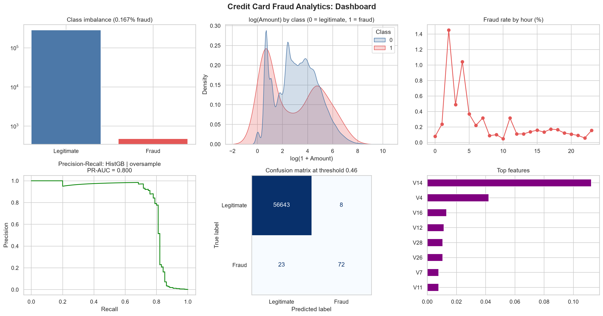

# Credit Card Fraud Analytics

## The problem
Banks and mobile money providers lose money when fraudulent payments slip through, and they annoy customers when genuine payments are blocked. In Kenya, where M-Pesa and card payments are used every day, catching fraud quickly matters a lot.

Fraud is also very rare (well under 1% of transactions). A model that says "everything is fine" would be over 99% accurate and completely useless, so this project uses metrics that handle rare events properly.

## Dataset
[Credit Card Fraud Detection](https://www.kaggle.com/datasets/mlg-ulb/creditcardfraud) (Kaggle, ULB).
- 284,807 European card transactions from two days in 2013
- 492 are fraud (473 remain after removing duplicate rows)
- Features V1 to V28 are anonymised for privacy
- Note: this is not Kenyan data. It is used here because it is the dataset specified in the internship brief.

The file `creditcard.csv` is about 150 MB, so it is stored in this repo with Git LFS (Large File Storage). If you clone the repo without Git LFS, download the file from the Kaggle link above and place it in the `data/` folder.

## What I did
1. Checked and cleaned the data
2. Looked at how rare fraud is (class imbalance)
3. Explored amounts and timing of fraud
4. Ran statistical tests and found which features separate fraud best
5. Split the data into train, validation and test sets
6. Tried three models and several ways of handling the imbalance
7. Measured them with Precision, Recall, F1, ROC-AUC and PR-AUC
8. Chose the decision threshold using business costs
9. Explained what false alarms and missed fraud cost
10. Checked which features drive the model's decisions

## Results

**Data.** 283,726 card transactions remained after removing 1,081 duplicate rows. Only 473 (0.167%, about 1 in 599) are fraud, so accuracy alone would be meaningless.

**What fraud looks like.**
- Fraud payments are usually small: the median fraud amount is 9.82 against 22.00 for legitimate payments, and a quarter of fraud payments are 1.00 or less. A few large fraud payments raise the average (123.87 vs 88.41).
- Fraud is concentrated in the early hours of the data. The fraud rate peaks above 1% around hours 2 and 4, against roughly 0.1 to 0.2% for most of the rest of the day. The hours are counted from the first transaction in the data, so they are not exact clock times.
- Amount alone cannot separate fraud from normal payments. The anonymised columns V14, V4 and V16 matter most to the model.

**Best model.** Gradient Boosting trained with oversampling of the fraud cases, chosen using the validation set and evaluated once on the untouched test set (95 frauds among 56,746 payments).

| Measure (test set) | Result |
|---|---|
| PR-AUC | 0.800 |
| ROC-AUC | 0.969 |
| Precision | 90.0% |
| Recall | 75.8% |
| Decision threshold | 0.46 (tuned on costs, not the default 0.50) |

It caught 72 of 95 frauds, missed 23, and wrongly flagged 8 genuine payments.

**Business impact.** Assuming a review costs 5.0 per flagged payment and a missed fraud costs its full amount, the estimated cost fell from 14,766 with no model to 3,852 with the model, a saving of 10,914 on the test set.

## Recommendations
1. Judge fraud models by PR-AUC and recall, not accuracy.
2. Set the alert threshold from business costs and re-tune it when costs or fraud patterns change.
3. Use risk tiers: approve low scores, ask for an OTP on medium scores, and block with manual review on the highest scores.
4. Monitor and retrain regularly, because fraud patterns change quickly.

## Limitations
- The test set has only 95 frauds, so these measures could move noticeably on different data.
- The data covers two days of European card payments, not Kenyan data, and the V columns are anonymised.
- A random split was used. A real system should be tested on later time periods.
- The review cost is an assumption.

## How to run
1. Install the packages: `pip install -r ../requirements.txt`
2. Make sure `creditcard.csv` is in `data/` (see the Dataset section)
3. Open `fraud_analytics.ipynb` in Jupyter or VS Code and run all cells