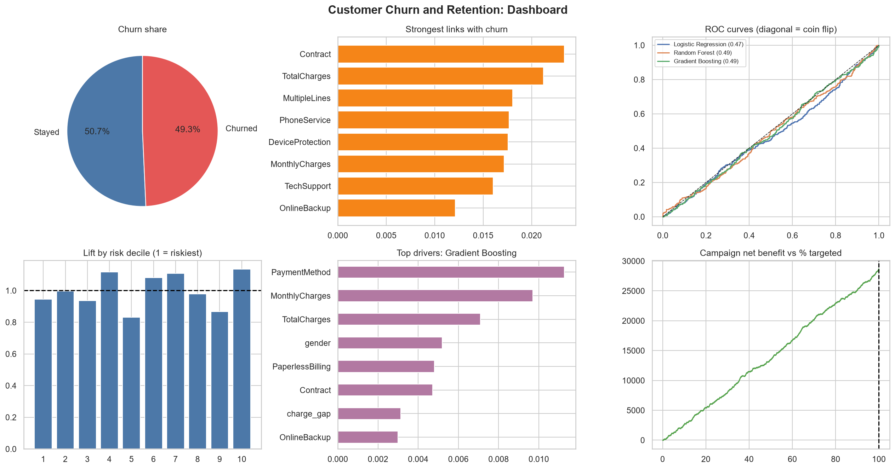

# Customer Churn and Retention Analytics

## The problem
Winning a new customer costs much more than keeping an existing one. A telecom, bank or subscription business in Kenya that can understand why customers leave, and predict who is about to leave, can spend its retention budget on the right people.

## Dataset
[Customer Churn Prediction Dataset](https://www.kaggle.com/datasets/rashadrmammadov/customer-churn-dataset) (Kaggle).
- 5,880 customers, 21 columns (services, contract, charges, tenure and a Churn label)
- 49.3% of customers churned (2,898 of 5,880)
- No missing values and no duplicate rows
- Note: this is not Kenyan data. It is used here because it is the dataset specified in the internship brief.

Download the CSV from the link above and place it in the `data/` folder if it is not already there.

## What I did
1. Cleaned the data and turned the churn label into 0 and 1
2. Explored churn by category and by numeric column
3. Ran statistical tests (chi-square and Mann-Whitney) with effect sizes, and checked for data leakage
4. Created new features (tenure groups, charge gap, number of services)
5. Compared three models with 5-fold cross-validation, then tested them on held-out customers
6. Checked whether the data carries any signal at all
7. Looked at churn drivers, risk deciles, lift and a retention campaign simulation

## Results

**The main finding: this dataset carries almost no signal about who churns.**
- None of the 19 columns is statistically linked to churn (all p-values above 0.05). The strongest link is 0.023 on a scale where 1 is perfect.
- All three models score a ROC-AUC of about 0.49 ⚠, which is no better than a coin flip (0.50). The best model, Gradient Boosting ⚠, reaches 48% recall and 48% precision ⚠.
- The riskiest 10% of customers churn at 47%, against 49% overall (a lift of about 0.9). The model cannot rank customers by risk.
- A churn rate near 50%, evenly spread categories, and no link between tenure, contract type or charges and churn are unusual for real telecom data. The file looks simulated.

**Campaign simulation.** Assuming an offer costs 20, keeps 30% of customers who would have left, and each kept customer is worth 300, an offer to everyone is profitable (net benefit 28,680 on the test set). That is because about half of all customers churn, not because the model helps.

## Recommendations
1. Check for signal before building a retention strategy.
2. Do not use these scores to target customers.
3. Collect behavioural data that changes before a customer leaves: usage trends, complaints, support calls, late payments and price changes.
4. Test any campaign with a control group to measure the real effect of the offer.

## Limitations
- The data is not Kenyan data and appears to be simulated.
- Links found in data are not proof of cause.
- The campaign economics are assumptions.

## How to run
1. Install the packages: `pip install -r ../requirements.txt`
2. Make sure the CSV is in `data/` (see the Dataset section)
3. Open `churn_analytics.ipynb` in Jupyter or VS Code and run all cells